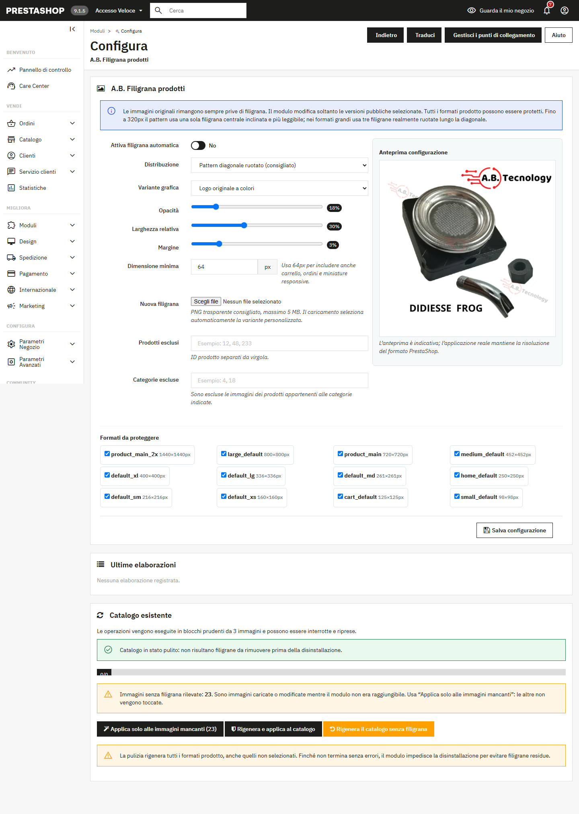

# abwatermark · filigrana automatica per PrestaShop 9

Modulo sviluppato da **Filippo Bonanno** per [A.B. Tecnology](https://www.abtecnologyricambi.it/) (in back office: "A.B. Filigrana prodotti"). Caso di studio completo: [abtecnology-prestashop](https://github.com/FilippoBonanno/abtecnology-prestashop).

- Filigrana applicata dall'hook `actionWatermark` a ogni nuovo caricamento o sostituzione di immagine, senza toccare gli originali.
- Lavorazione del catalogo esistente dal back office a blocchi di 3 immagini (niente timeout su hosting condivisi), con recupero delle sole immagini rimaste scoperte e protezione dalla doppia filigrana.
- Anteprima prima di attivarlo; disinstallazione bloccata finché il catalogo non è stato rigenerato pulito.
- PHP + GD, nessuna dipendenza esterna; aggiornamenti incrementali in `upgrade/`.

Back office di un PrestaShop 9.1 di prova: impostazioni, anteprima, formati protetti e lavorazione del catalogo esistente.

---

## Guida d'uso (versione 1.0.x)

Modulo PrestaShop 9 per applicare automaticamente filigrane alle immagini prodotto tramite l’hook `actionWatermark`.

## Installazione

1. Caricare `abwatermark.zip` da **Moduli > Gestione moduli > Carica un modulo**.
2. Installare il modulo.
3. Aprire **Configura**, scegliere modalità, opacità, dimensione e formati immagine.
4. Il modulo viene installato disattivato: abilitarlo soltanto dopo aver verificato l’anteprima.
5. Provare il caricamento di una nuova immagine prodotto.
6. Solo dopo il controllo usare la lavorazione del catalogo esistente.

## Aggiornamento dalla 1.0.2 o 1.0.3

1. Caricare lo ZIP 1.0.4 dal gestore moduli e avviare **Aggiorna**.
2. Provenendo dalla 1.0.2, l’upgrade seleziona automaticamente tutti i formati prodotto e imposta la dimensione minima a 64px. Dalla 1.0.3 mantiene la configurazione esistente.
3. Controllare l’anteprima e salvare la configurazione desiderata.
4. Eseguire una volta **Rigenera e applica al catalogo** per uniformare card, carrello, miniature, pagina prodotto e zoom.
5. Verificare il risultato con un aggiornamento forzato del browser, perché gli URL delle immagini possono essere conservati in cache.

## Recupero delle immagini senza filigrana

Se la filigrana automatica non ha lavorato per un periodo (modulo disattivato, permessi mancanti sul profilo che ha caricato le immagini, errori dell'hook), il pannello mostra quante immagini risultano scoperte e propone **Applica solo alle immagini mancanti**.

1. Riattivare la filigrana automatica e verificare che il profilo che carica i prodotti veda il modulo.
2. Controllare il conteggio nel riquadro "Catalogo esistente".
3. Eseguire **Applica solo alle immagini mancanti**: vengono rielaborate esclusivamente le immagini prive di una lavorazione riuscita più recente dell'ultima pulizia. Le immagini già filigranate non vengono toccate, quindi non si rischia una doppia filigrana.

Ogni immagine trattata viene comunque ricostruita dall'originale prima di ricevere la filigrana: anche un eventuale falso positivo resta con una sola filigrana.

## Rimozione sicura

1. Disattivare la filigrana automatica.
2. Eseguire **Rigenera il catalogo senza filigrana**. La pulizia rigenera tutti i formati prodotto, compresi quelli eventualmente deselezionati dopo l’applicazione.
3. Verificare che la lavorazione termini con zero errori e controllare alcune immagini con un aggiornamento forzato del browser.
4. Disinstallare il modulo. Se il catalogo risulta ancora filigranato o la pulizia ha avuto errori, la disinstallazione viene bloccata.

Le lavorazioni vengono eseguite in blocchi da 3 immagini per ridurre il rischio di timeout sugli hosting condivisi.

La versione 1.0.4 protegge anche i formati responsive piccoli usati dalle card Hummingbird e ruota realmente la filigrana nella modalità diagonale. Sulle miniature fino a 320px applica una sola filigrana centrale inclinata, con dimensione e opacità adattive. Corregge inoltre gli aloni e i rettangoli scuri che potevano comparire sulle immagini ad alta risoluzione dopo la rotazione.

Gli originali PrestaShop (`img/p/.../<id>.jpg`) non vengono mai filigranati.
